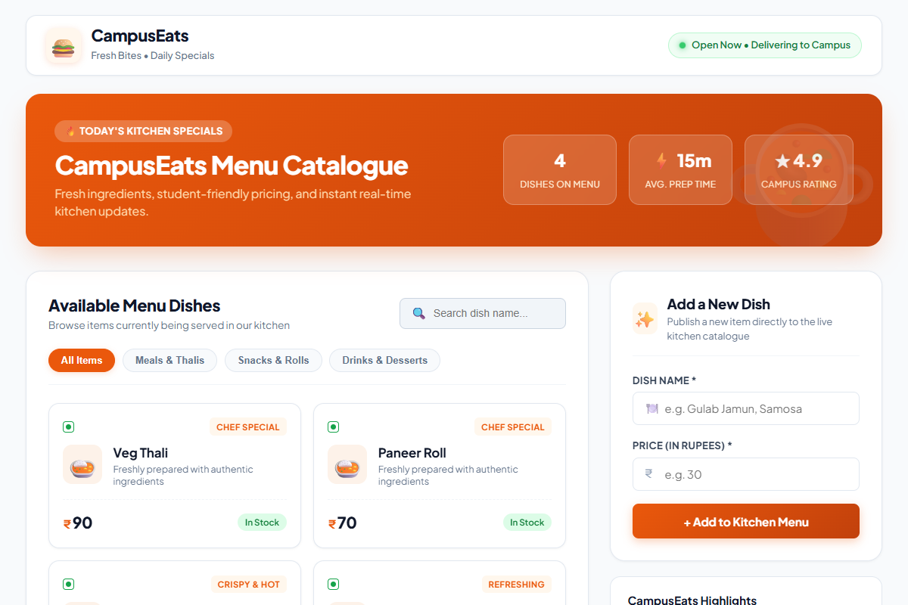
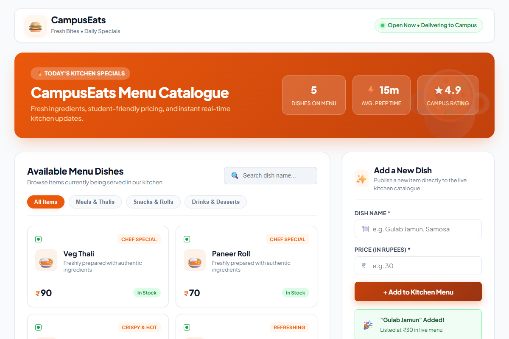

# CS543 Web Services · Assignment 8 of 12
## Build One CampusEats Service as a REST API
**Course:** CS 543 Web Services &bull; **Instructor:** Dr. Pramit Mazumdar &bull; **Institute:** IIIT Vadodara

---

## 👥 Team 11 Members

| Name | Student Roll No. | Role & Contribution |
| :--- | :--- | :--- |
| **Nandini Kanaujiya** | `20251651061` | REST API routes, data validation & handler implementation |
| **Radhika Verma** | `20251651075` | Express middleware integration & schema architecture |
| **Alka Jha** | `20251651013` | Frontend fetch integration, styles & dynamic refresh |
| **Alok Mishra** | `20251651014` | API testing, error scenarios & automated verification |

---

## 🔗 Submission Links & Deliverables

* **GitHub Repository:** [https://github.com/Nandinikanaujiya/campuseats/tree/main/Assignment-8](https://github.com/Nandinikanaujiya/campuseats/tree/main/Assignment-8)
* **Demonstration Video:** [`demonstration.mp4`](demonstration.mp4) (H.264 MP4; plays natively in Windows Media Player & browsers)
* **Interactive Player:** [`demonstration.html`](demonstration.html)
* **Animated Demo GIF:** [`demonstration.gif`](demonstration.gif)
* **Submission Brief PDF:** [`ReadMe.pdf`](ReadMe.pdf)

---

## 📝 Answers to Assignment Questions

### 1. Which CampusEats service did you pick, and what are its routes (method + path)?
We selected the **Menu / Catalogue Service** of CampusEats.  
The entity model consists of: `id` (Number), `name` (String), `price` (Number), and `available` (Boolean).

Its RESTful routes are:
| Method | Path | Description |
| :--- | :--- | :--- |
| **GET** | `/items` | Retrieves the entire menu catalogue |
| **GET** | `/items/:id` | Retrieves a single dish by its unique numerical identifier |
| **POST** | `/items` | Creates and adds a new dish to the live kitchen catalogue |

---

### 2. Which status codes did you return, and for which outcomes (200 / 201 / 404 / 422)?

* **`200 OK`**:
  * Returned on `GET /items` when the menu array is successfully retrieved.
  * Returned on `GET /items/:id` when the requested item exists in the collection.
* **`201 Created`**:
  * Returned on `POST /items` upon successful creation and insertion of a new dish into the menu array.
* **`404 Not Found`**:
  * Returned on `GET /items/:id` when no dish matches the provided `:id` parameter (e.g. `GET /items/99`). The client receives a descriptive JSON payload: `{"error": "not found"}`.
* **`422 Unprocessable Entity`**:
  * Returned on `POST /items` when semantic client-side payload validation fails (specifically when the mandatory `name` field is omitted, empty, or whitespace only). The client receives: `{"error": "name required"}`.

---

### 3. Where did you use `req.params` and where `req.body`? Why does POST need `express.json()`?

* **`req.params` Usage:**
  * Used in **`GET /items/:id`** via `req.params.id`. Route parameters are captured directly from the URL path. Because URL route segments are parsed as strings, we cast it via `Number(req.params.id)` to perform strict type matching against stored item IDs.
* **`req.body` Usage:**
  * Used in **`POST /items`** to extract the payload fields `{ name, price, available }` sent by the client.
* **Why does POST need `express.json()`?**
  * Node's underlying HTTP server provides incoming request bodies as a raw, chunked data stream of byte buffers. Without body-parsing middleware, Express does not parse this stream into JavaScript objects, leaving `req.body` as `undefined`.
  * The `express.json()` built-in middleware intercepts requests with `Content-Type: application/json`, buffers the byte stream chunks, parses the raw JSON string, and populates `req.body` with a fully formed JavaScript object ready for route handlers to inspect and validate.

---

## 📸 Before & After POST Screenshots

| 1. Before POST (4 Seed Dishes) | 2. After POST (Live Addition Verified) |
| :---: | :---: |
|  |  |
| *Initial page state with 4 seed records* | *Live updated page displaying newly added dish* |

---

## 🚀 How to Run

1. Open terminal in `Assignment-8`:
   ```bash
   npm install
   node server.js
   ```
2. Open your web browser at:
   ```
   http://localhost:3000
   ```
3. Test with curl:
   ```bash
   # List items (200 OK)
   curl -i http://localhost:3000/items

   # Fetch single item (200 OK)
   curl -i http://localhost:3000/items/1

   # Missing item (404 Not Found)
   curl -i http://localhost:3000/items/99

   # Add dish (201 Created)
   curl -i -X POST http://localhost:3000/items -H "Content-Type: application/json" -d "{\"name\":\"Gulab Jamun\",\"price\":30}"

   # Invalid payload (422 Unprocessable)
   curl -i -X POST http://localhost:3000/items -H "Content-Type: application/json" -d "{\"price\":30}"
   ```
